# Saathi — the AI workspace that remembers

Team chat with a personal AI colleague built in. Saathi **finds any chat, drawing or certificate with a cited source**, **briefs you on what you missed**, **turns promises into tracked tasks**, and helps teams **decide with evidence**. A manufacturing layer reads engineering drawings, mill test certificates and inspection reports; the demo runs it for a fictional Indian rail-component plant, Shakti Rail Components.

- **Live app:** https://saathi-web-82398575445.asia-south1.run.app (landing → *Open live demo* → pick a colleague; **Demo guide** in the header shows what to try)
- **API health:** https://saathi-api-82398575445.asia-south1.run.app/health

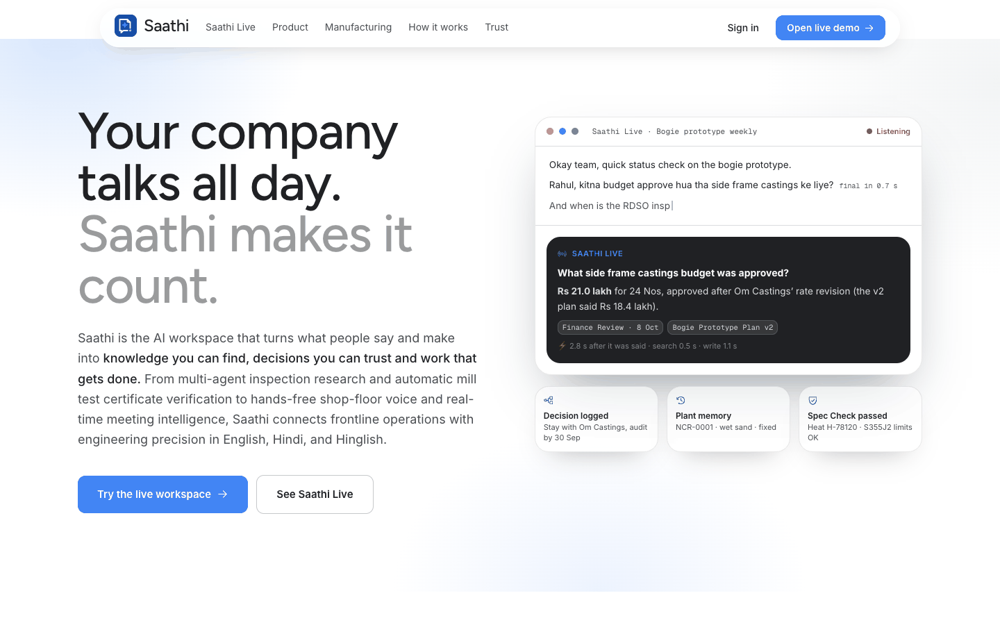

## Contents

- [The problem](#the-problem)
- [What Saathi does](#what-saathi-does)
- [A tour in screenshots](#a-tour-in-screenshots)
- [Architecture](#architecture)
- [Security and privacy](#security-and-privacy)
- [Evaluation](#evaluation)
- [Feature reference](#feature-reference)
- [Repository layout](#repository-layout)
- [Run locally](#run-locally)
- [Configuration and secrets](#configuration-and-secrets)
- [Demo data](#demo-data)
- [Deploy (CI/CD)](#deploy-cicd)

## The problem

On a plant floor and in the office around it, the knowledge needed for the next job is scattered. A drawing revision is approved in one chat, a vendor promises a dispatch date by email, the certificate sits in a PDF, and the reason for a decision lives in a meeting nobody wrote up. People ask around, re-argue settled decisions, miss commitments, and repeat quality problems because nobody can find how the last one was fixed. Vendors and contractors need some of this, but not all of it.

## What Saathi does

| | |
| --- | --- |
| **Find knowledge** | Ask in English, Hindi or Hinglish. Saathi answers only from what you are allowed to open, cites every source, and shows the steps it took. |
| **Work together** | Chats, channels and threads; promises and decisions are spotted as people type; vendors join as guests with their own limits and an end date; Google Calendar, Gmail and Drive come in read-only. |
| **Decide with evidence** | Research agents build cited readiness reports and turn gaps into tasks; Spec Check verifies certificates against approved limits in code; the decision log keeps what was decided and why. |
| **Get the day done** | My Day ranks what needs you; meetings get a live copilot and notes that become tasks; the shop floor talks to Saathi hands-free; shift handovers draft themselves. |

Three rules run through all of it: **AI never files anything silently** (tasks, records and handovers are drafts a person confirms), **every answer cites its source**, and **permissions are checked when the question is asked**, so nobody sees an answer built from something they couldn't open.

## A tour in screenshots

**My Day.** What needs you, ranked: overdue tasks, drafts to confirm, records, shift handovers, mentions and promises found in email, next to today's meetings.

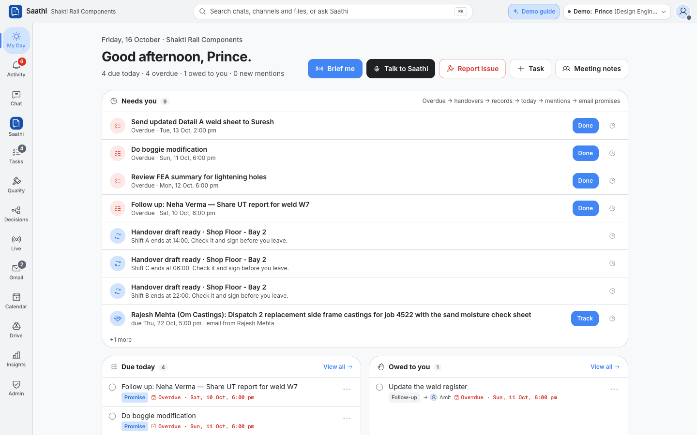

**Ask Saathi, with sources.** Every claim links to the drawing, decision or chat it came from; *How Saathi got this* lists the tools used, the sources cited and the time taken.

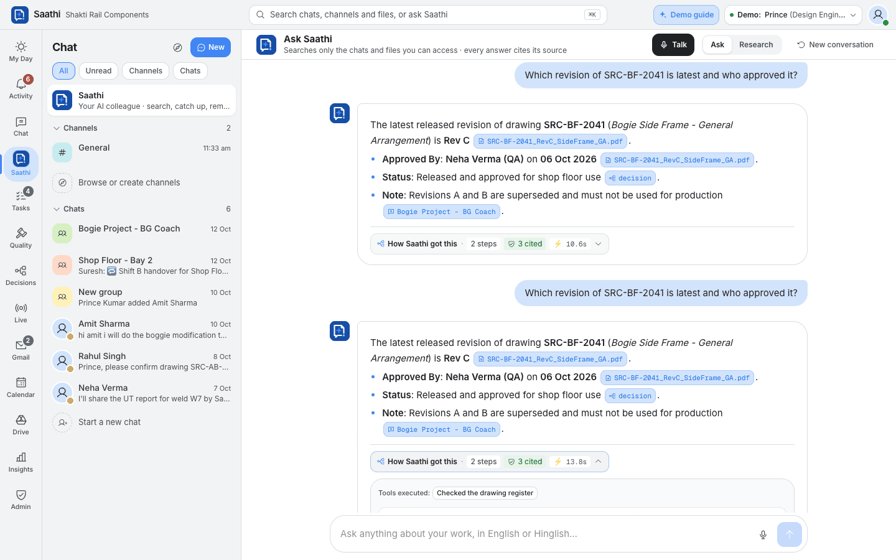

**Saathi Research.** "Are we ready for the RDSO inspection on 20 Oct?" Six agents checked 41 items in parallel; a verifier wrote the verdict, and every claim is tied to a source.

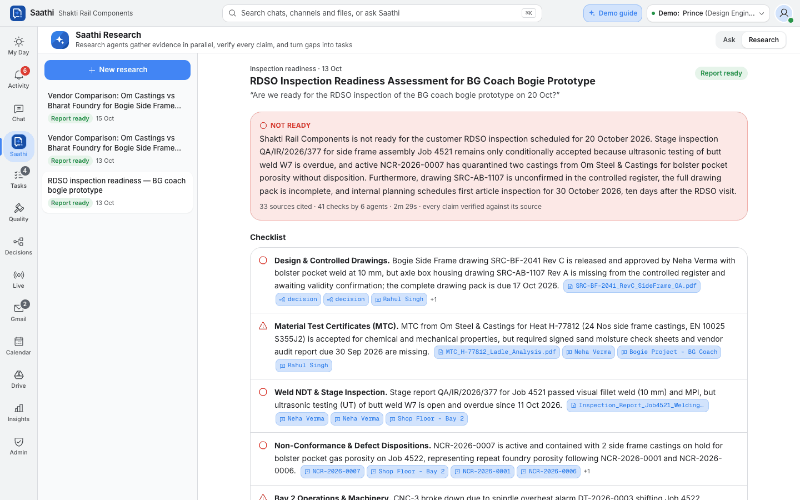

**Chat that notices.** Saathi logs the decision when Rev C is approved and offers to track the promises people make, assigned to whoever made them.

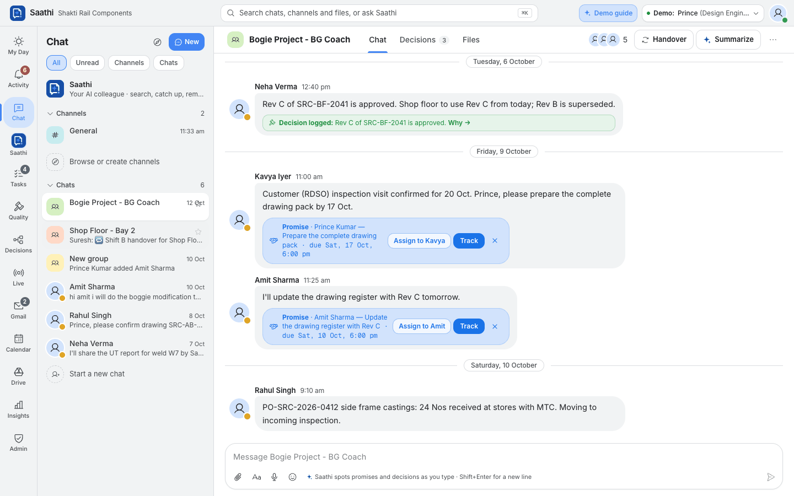

**Spec Check and the Standards Library.** Certificate values are extracted by Gemini and judged by code against the approved limits; the standards are searchable by Saathi.

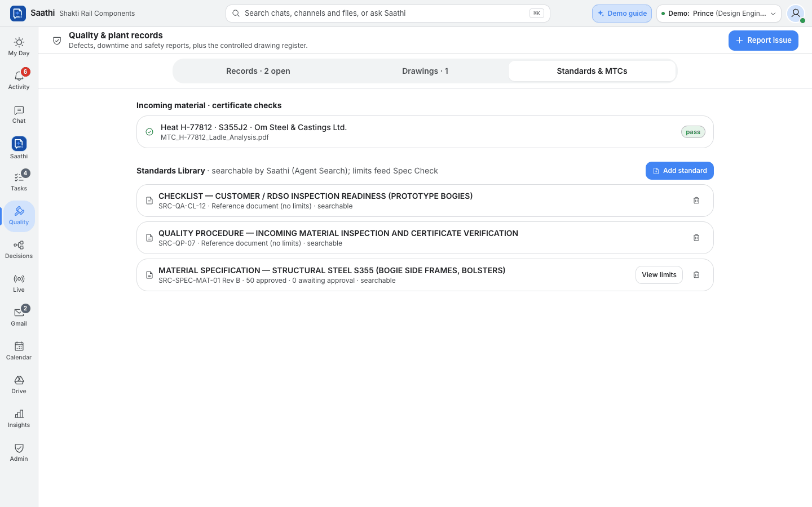

**Decisions.** Captured from chats and meetings, with who decided, why, what was rejected and what a newer decision replaced.

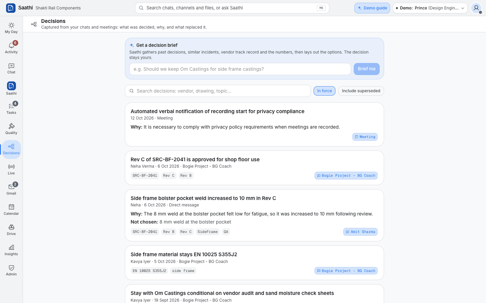

**Calendar and Google Meet.** Meetings with *Prep me* (a brief from your email, Drive and chats), *Join*, *Start Saathi Live* and notes. (The shared demo logins show sample Google data.)

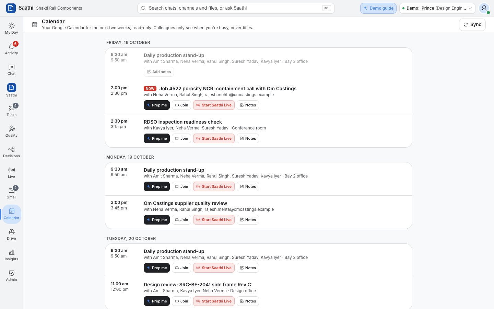

**Guided tour and Demo guide.** The tour lights up one control at a time on the real screens; the Demo guide lists every flow with something to try.

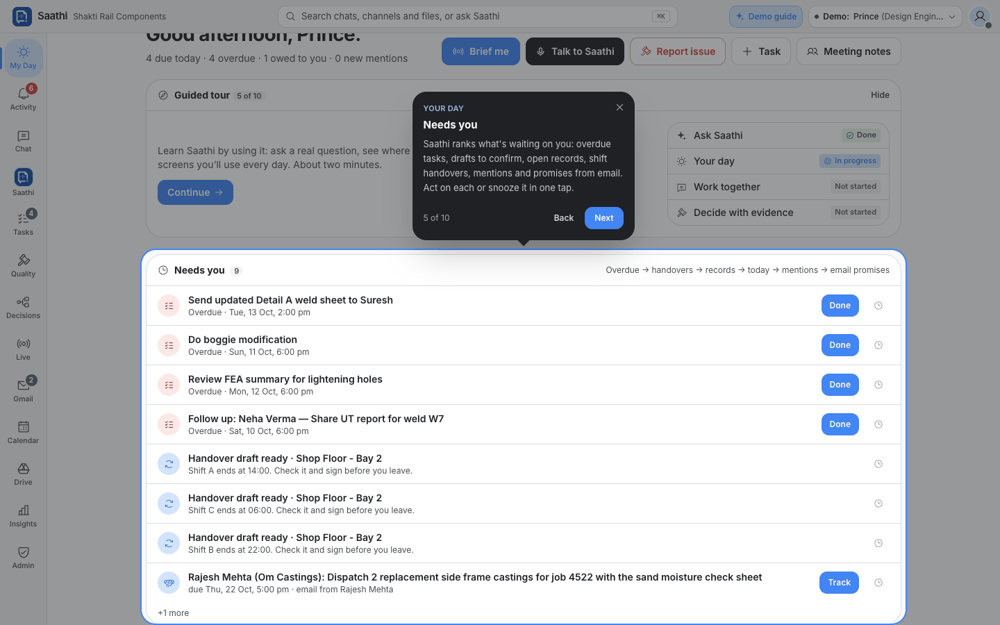

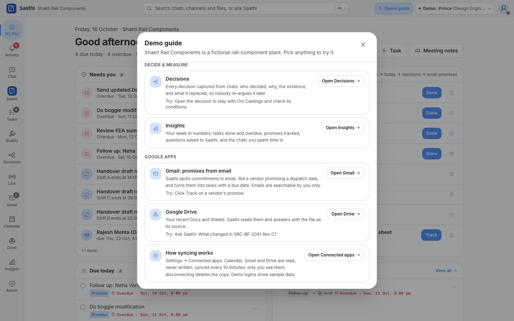

**Insights**, private to each person: tasks, promises, where the week went and how Saathi was used.

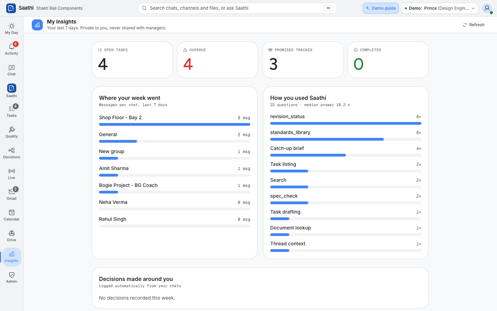

<table>
<tr>
<td width="55%" valign="top"><b>Guests with limits.</b> An admin decides what a vendor can do besides their channels (direct messages, Saathi) and for how long. Someone who already uses Saathi at their own company keeps that workspace and switches between the two.<br><br>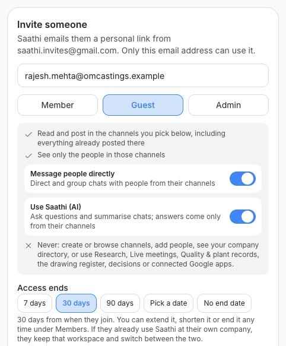</td>
<td width="45%" valign="top"><b>On the phone.</b> The same workspace with a bottom bar for the shop floor: My Day, Chat, Quality, Live and Tasks.<br><br>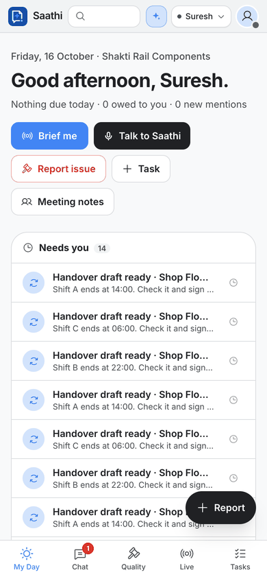</td>
</tr>
</table>

## Architecture

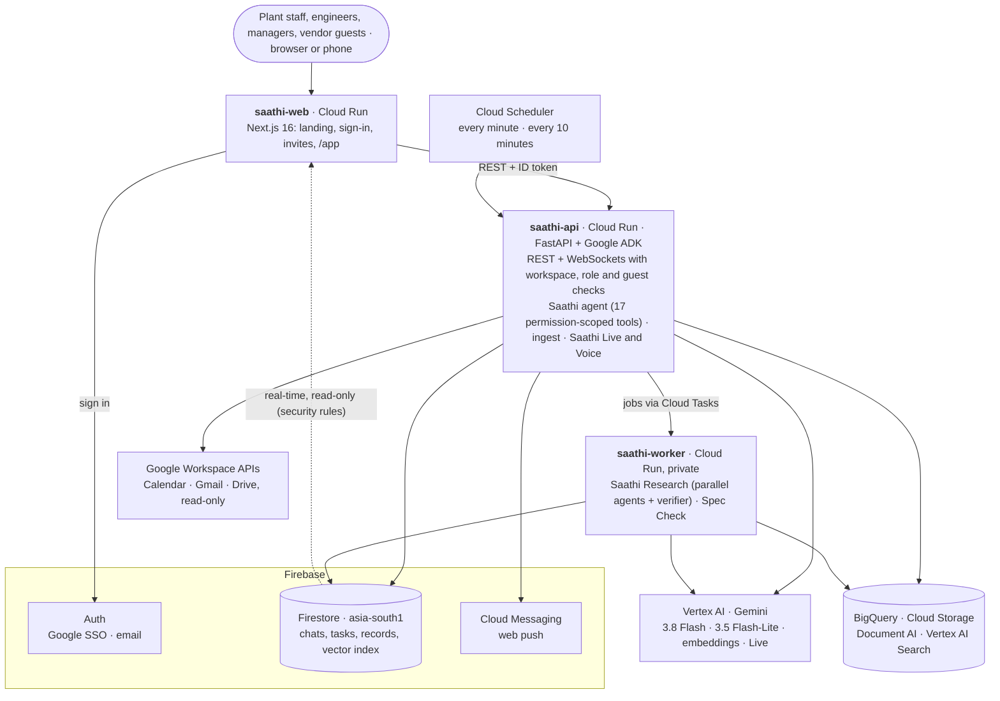

**The browser only reads.** It signs in with Firebase Auth and listens to Firestore in real time, so new messages, streaming answers and research progress appear without polling. Security rules let a person read only their workspace's documents they are a member of. Every write goes through the API, which checks the workspace, the role, guest limits and membership first.

**How a question is answered:**

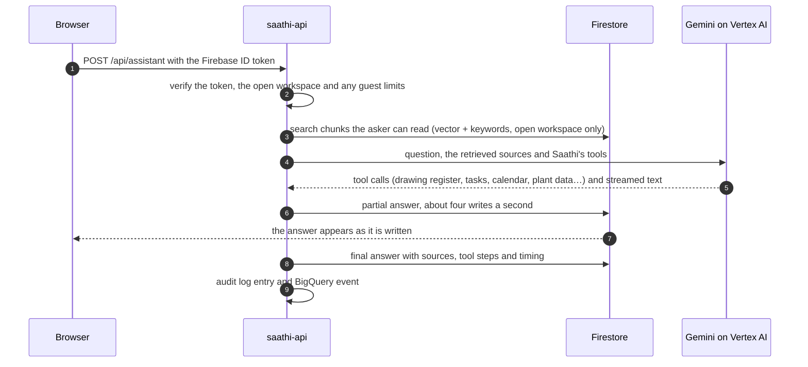

### Google Cloud services

| Service | What Saathi uses it for |
| --- | --- |
| Cloud Run | `saathi-web` (Next.js), `saathi-api` (FastAPI + ADK) and `saathi-worker` (the same image, private, only the job routes) in asia-south1 |
| Vertex AI · Gemini | The agent (Gemini 3.8 Flash, falls back to 3.5 Flash), fast classification (3.5 Flash-Lite), embeddings (`gemini-embedding-001`, asia-south1), live transcription, spoken notices, and Saathi Voice on Gemini Live (us-central1) |
| Google ADK | The Saathi agent and the Research workflow (`SequentialAgent` of `ParallelAgent` waves, then a verifying critic) |
| Firestore | Hot data and the vector index, with membership pre-filters; point-in-time recovery (7 days), delete protection, daily backups kept 14 days |
| Firebase Auth, Cloud Messaging | Google SSO and email sign-in; web push for mentions, replies, tasks and reminders |
| Document AI | OCR for drawings, certificates and reports (asia-south1), then Gemini reads title blocks, revision tables and certificate values |
| Vertex AI Search | The workspace Standards Library that Saathi and Spec Check search |
| BigQuery | `saathi_archive.chunks` for deep research (`VECTOR_SEARCH` with permissions applied at query time), `saathi.plant_*` for plant-data charts, `saathi.assistant_events` for usage |
| Cloud Storage | Uploaded files and voice notes |
| Cloud Tasks | Research runs and certificate checks, with retries, rate limits and survival across restarts |
| Cloud Scheduler | `saathi-reminders` every minute (due reminders, guest access end dates, handover drafts, meeting prompts) and `saathi-sync` every 10 minutes (Google sync, plant data) |
| Cloud KMS, Secret Manager | Encrypting Google refresh tokens; the OAuth client, cron secret and invite-mail password |
| Workload Identity Federation | Keyless deploys from GitHub Actions |

### Design choices that matter

- **Permissions at question time.** Retrieval is filtered to the chats a person belongs to *now*, and results are re-checked before they reach the model, so joining or leaving a channel never needs a re-index. Personal sources (email, Drive, meetings, knowledge) are filtered to their owner.
- **Retrieval first, then one model turn.** Most questions are answered with the sources fetched up front and a single model turn, streamed as it is written (median 3.8 s, first words in 2.8 s).
- **Code decides where it must.** Gemini reads certificate values; code compares them with the approved limits for the grade on the drawing's current revision. Research citations are re-checked by code against what the tools actually returned.
- **Workspaces and guests.** Every document carries its workspace; token claims hold the open workspace and role. One account can belong to several workspaces (a supplier's engineer is a guest in each customer's), and Saathi only reads the open one. A guest's access can end on a date: a minute-by-minute sweep takes them out of that workspace's chats, and extending it puts them back.
- **Resilience.** Every model call retries with backoff and jitter, then falls back to a second model; a research agent that still fails reports "unknown" instead of breaking the report.
- **Data residency.** Firestore, Cloud Storage, Document AI, embeddings and the archive run in asia-south1 (Mumbai).

## Security and privacy

- No secrets in the repository; configuration is read from Cloud Run environment variables at request time and secrets from Secret Manager.
- Firestore rules: reads only, and only within your workspace and the chats, files, tasks and records you are part of. All writes go through the API.
- Per-chat **Hidden from AI** removes a chat from Saathi's index; admins see channel names and membership, never messages.
- Google data is read-only, visible only to the person who connected it, and deleted on disconnect. Shared demo logins can't connect a real account and show sample data instead.
- Every question to Saathi and every admin action is written to the audit log.

## Evaluation

Run from `agent/eval`:

| Metric | Result | Target |
| --- | --- | --- |
| Retrieval accuracy (answer cites the correct source) | 10/10 | ≥ 8/10 |
| Permission leaks (adversarial questions) | 0 | 0 |
| Plain-language task parsing (date + hour, English & Hinglish) | 4/4 | — |
| Promise detection precision / recall (20 labelled messages) | 1.0 / 1.0 | ≥ 0.80 precision |
| Median answer latency (retrieval-first + streaming) | 3.8 s (first words 2.8 s) | ≤ 4 s |
| Spec Check comparator / certificate extraction | 20/20 · 2/2 | 100% |
| Saathi Research gold-gap recall · claims with a verified source · leaks | 5/5 + 4/4 · 100% · 0 | ≥ 80% · 100% · 0 |

Re-run with `uv run python -m eval.run_eval` and `uv run python -m eval.phase4_eval`, then `uv run python -m eval.export_web` to refresh the numbers shown on the landing page.

## Feature reference

| Area | What it does |
| --- | --- |
| Ask Saathi | ADK agent (Gemini 3.8 Flash, low thinking level) with permission-scoped tools; retrieval-first, streamed answers; every claim a clickable source chip; *How Saathi got this* under each answer; English, Hindi and Hinglish |
| Saathi Research | A goal (*"Are we ready for the RDSO inspection on 20 Oct?"*) becomes an editable plan; research agents run in parallel over your permission-scoped tools; a verifying agent writes the report and code re-checks every citation; live progress; each gap becomes a task in one click; sharing checks each source against the chat's members. Templates: inspection readiness, vendor comparison, custom |
| Inspection Dossier | Turns a finished readiness report into the inspector's evidence pack (PDF): only verified content, drawings re-checked against the register, every page footed with its source |
| Spec Check & Standards Library | Company specs, procedures and checklists indexed in Vertex AI Search; Gemini proposes acceptance limits for QA approval. A certificate is checked seconds after upload: Gemini reads the values, code decides pass/fail for the grade on the drawing's current revision (thickness bands, test temperature, units); a failure drafts the NCR |
| Drawing register & Revision Guard | Register rebuilt from document extraction; drafts visible only to people who can open the file; QR-stamped controlled copies whose public check shows only drawing number, revision and current/superseded |
| Plant records & memory | A photo, voice note or a few words become a drafted NCR, downtime or safety record a person confirms; Saathi finds similar past problems and what fixed them; anonymous safety reports never store the reporter |
| Plant data | "NCRs by vendor this quarter" becomes a chart: Gemini fills a fixed query spec, the server builds a parameterised BigQuery query scoped to the asker |
| Decision log | Decisions from chats and meetings with what, why, rejected options, who and the source; newer decisions supersede older ones; visibility follows the source |
| Shift handover | Near the end of a shift Saathi drafts the handover for a bay from what the shift said and filed; the outgoing lead signs, the incoming crew acknowledges, and an unacknowledged handover escalates |
| Saathi Live | In-meeting assistant: the browser streams the meeting audio, Gemini transcribes it and spots questions, which are answered in seconds with citations; notes plus transcript become an enhanced summary with action items; an optional spoken recording notice |
| Saathi Voice | Hands-free and Hindi-first on Gemini Live with Saathi's tools; a record or reminder is filed only after the person confirms it in their own words; transcripts kept 30 days |
| Catch-up & promises | *Today / 3 days / This week* briefs; commitments detected in any chat or email become one-click tracked tasks with reminders |
| Work management | Tasks with assignee, watchers and status; My Day; meeting notes become summaries, decisions and assigned tasks; plain-language reminders (*"Kal subah 10 baje … reminder"*) |
| Google connector | Settings → Connected apps: Calendar, Gmail and Drive, read-only. Server-side OAuth, refresh tokens encrypted with Cloud KMS; today's meetings with *Prep me*, *Join* and notes; colleagues see "In a meeting" from free/busy only; email promises become tasks; Drive Docs and Sheets answerable by Saathi; sync every 10 minutes; disconnect deletes the copy; admins can turn it off |
| Workspaces, invites & guests | Invites are personal links (emailed from saathi.invites@gmail.com, or copied / shared on WhatsApp) that only the invited address can accept, valid 14 days. Roles: owner, admin, member, guest. Per guest the admin allows or blocks direct messages and Saathi and sets an end date (30 days by default). One account can belong to several workspaces, switched from the header |
| Admin console | Members and roles, guest access, deactivation, invites, channel governance (no message access), workspace settings, impact numbers and the audit log |
| Chat | Teams-style app rail; chats and channels in one list with filters; threads; reactions; mentions; presence and status; per-chat notification levels and quiet hours; web push; Messages · Decisions · Files tabs; ⌘K palette |
| Onboarding | Guided tour on the real screens (hands-on first question); Demo guide for the shared demo logins |
| Insights | Personal 7-day view: tasks, overdue, promises, Saathi usage, busiest chats |
| Audit | Every assistant question and tool call to the Firestore audit log and BigQuery `saathi.assistant_events` |

## Repository layout

```
agent/                 FastAPI + Google ADK (Cloud Run: saathi-api and saathi-worker); uv for Python
  app/main.py          chats, channels, messages, tasks, assistant, cron
  app/agent.py         the Saathi agent and its tools
  app/search.py        permission-aware hybrid retrieval
  app/ingest.py        embeddings, promise/decision detection, document extraction
  app/research.py      multi-agent research; dossier.py builds the inspection pack
  app/specs.py         Spec Check and the Standards Library
  app/live.py, voice.py  Saathi Live and Saathi Voice
  app/invites.py, workspaces.py, admin.py  invites, guest access, multiple workspaces, admin console
  app/connectors.py    Google Calendar, Gmail and Drive
  eval/                evaluation suite
  seed/                demo data
web/                   Next.js 16 + React 19 + Tailwind 4 (Cloud Run: saathi-web)
  src/app/             routes: / (landing), /login, /signup, /invite/[token], /app, /privacy, /r/[token] (QR check)
  src/components/      workspace UI
docs/                  product requirement documents and screenshots
firestore.rules        browser read rules
.github/workflows/     CI/CD
```

## Run locally

Against the Google Cloud project:

```bash
gcloud auth application-default login && gcloud auth application-default set-quota-project aibuildergc
cd agent && uv sync && uv run uvicorn app.main:app --port 8080
cd web && npm install && npm run dev          # http://localhost:3000
```

Offline, without a Google Cloud project (a local JSON database and local sign-in; set `GEMINI_API_KEY` for AI answers):

```bash
cd agent && SAATHI_LOCAL=1 uv run uvicorn app.main:app --port 8080
cd web && SAATHI_LOCAL=1 SAATHI_API_URL=http://localhost:8080 npm run dev
```

## Configuration and secrets

No environment files or secrets are committed (`.env*` is git-ignored; only `web/.env.example` is tracked).

| Where | How |
| --- | --- |
| Web (local) | `cp web/.env.example web/.env.local` and fill in the Firebase web config + API URL |
| Web (Cloud Run) | `gcloud run deploy saathi-web --set-env-vars SAATHI_API_URL=…,FIREBASE_API_KEY=…,…` |
| API | Env vars on Cloud Run: `DOCAI_PROCESSOR`, `BQ_TABLE`, `ALLOWED_ORIGINS`, `SIGNUP_DOMAINS` (optional), model overrides (`AGENT_MODEL`, `AGENT_FALLBACK_MODEL`, `FAST_MODEL`, `VISION_MODEL`, `AGENT_THINKING`); jobs: `SAATHI_ROLE` (api/worker), `TASKS_MODE=cloudtasks`, `WORKER_URL` (set by CI) |
| Invite email | Sent from **saathi.invites@gmail.com**, a Gmail mailbox kept only for this (about 500 emails a day; bounces land in its inbox). CI sets `SMTP_HOST=smtp.gmail.com`, `SMTP_PORT=587`, `SMTP_USER`, `MAIL_FROM` on saathi-api; the Gmail app password is Secret Manager `saathi-smtp-password` (asia-south1), mounted as `SMTP_PASSWORD` (one-time setup below). Any SMTP provider works (Google Workspace, SendGrid, Brevo): change those env vars. Until the password is mounted, email stays off and invites still work: admins copy the personal link or share it on WhatsApp |
| Cron secret | Secret Manager `saathi-cron-secret`, mounted as `CRON_SECRET` |
| Google OAuth client | Secret Manager `saathi-google-oauth` (asia-south1), mounted as `GOOGLE_OAUTH_CLIENT`. Redirect URI `…/api/connectors/google/callback`. Consent screen in Testing: add each user as a test user |

**Invite email, one-time setup.** Sign in to saathi.invites@gmail.com, turn on 2-Step Verification and create an app
password (myaccount.google.com/apppasswords). Then store it, typed at a hidden prompt so it never reaches the terminal
history (zsh; in bash use `read -rsp "App password: " P`), let the API read it, and mount it:

```bash
read -rs "P?App password: " && printf '%s' "${P// /}" | gcloud secrets create saathi-smtp-password --project aibuildergc \
  --replication-policy=user-managed --locations=asia-south1 --data-file=- ; unset P
gcloud secrets add-iam-policy-binding saathi-smtp-password --project aibuildergc \
  --member serviceAccount:saathi-agent@aibuildergc.iam.gserviceaccount.com --role roles/secretmanager.secretAccessor
gcloud run services update saathi-api --region asia-south1 --project aibuildergc --update-secrets SMTP_PASSWORD=saathi-smtp-password:latest
```

A new app password goes in with `gcloud secrets versions add saathi-smtp-password --data-file=-` and takes effect on the
next API revision (redeploy, or rerun the `services update` line). Revoking the app password in Google stops all invite email at once.

## Demo data

```bash
cd agent
uv run python seed/make_pdfs.py   # synthetic PDFs (drawings Rev B/C/D, MTC, quote, inspection report)
uv run python -m seed.seed        # full rebuild (wipes the workspace!)
uv run python -m seed.reset       # fast reset: clears assistant chats, tasks, alerts and messages added after seeding
uv run python -m seed.google_demo # sample Gmail, Calendar (Google Meet) and Drive for the shared demo logins; --remove deletes it
```

## Deploy (CI/CD)

Merging to `main` deploys automatically through GitHub Actions (`.github/workflows/ci-cd.yml`):

1. Open a pull request into `main`. CI builds and type-checks `web/` and installs and compiles `agent/` (only the folders the PR touches).
2. Merge it. The push to `main` re-runs the checks, then deploys only what changed: `firestore.rules` → Firestore security rules (first), `agent/**` → **saathi-api**, `web/**` → **saathi-web** (API first when both change), followed by a health check.
3. Watch it under **Actions** or **Deployments → production** on GitHub. Each Cloud Run revision is labelled with the commit SHA.

To redeploy without a code change: **Actions → CI/CD → Run workflow** (choose api, web or both) on `main`.

Auth is keyless: GitHub OIDC → Workload Identity Federation (pool `github`, provider `saathi-repo`) → service account `github-deployer`. The provider only trusts workflows from `ojha-436/Saathi` running on `refs/heads/main`, so branches and forks can't deploy. Deploys keep the existing Cloud Run env vars and secrets; change those with `gcloud run services update`.

Manual deploy (fallback):

```bash
cd agent && gcloud run deploy saathi-api --source . --region asia-south1
cd web   && gcloud run deploy saathi-web --source . --region asia-south1
```

## Team

| Frontend & product | AI & backend |
| --- | --- |
| `web/` landing, workspace UX, accessibility | `agent/app/agent.py` tools and prompts, `agent/eval` |
| Insights, palette, chat tabs | Ingest pipeline, Document AI, BigQuery |
| Demo and walkthroughs | Latency work (target < 5 s) |
